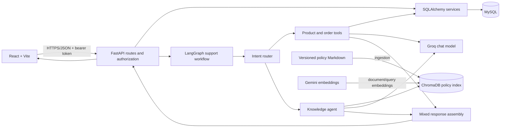
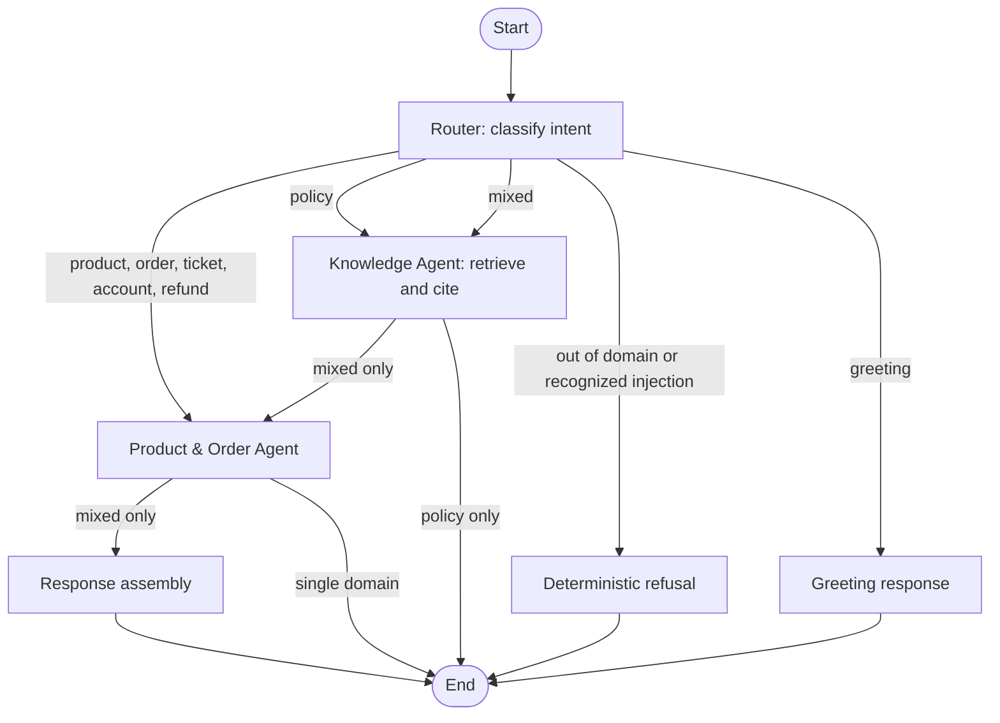
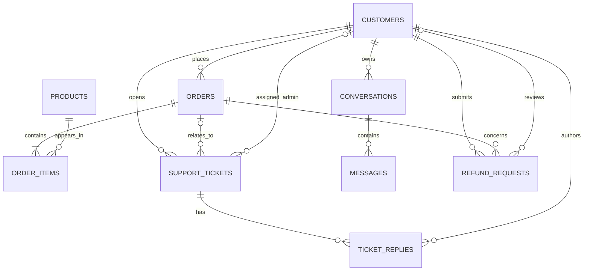

<div align="center">
# 🛍️ SupportSphere
 
### E-commerce customer support with role-based workflows and a policy-grounded, multi-agent AI assistant
 
[](https://www.python.org/)
[](https://fastapi.tiangolo.com/)
[](https://react.dev/)
[](https://www.mysql.com/)
[](https://langchain-ai.github.io/langgraph/)
[](https://www.trychroma.com/)
 
### 🚀 [Live demo on Railway](https://ai-customer-support-production-3b00.up.railway.app/)
 
</div>
---
 
## Table of contents
 
- [Overview](#overview)
- [Key features](#key-features)
- [Live demo](#live-demo)
- [Architecture](#architecture)
- [Tech stack](#tech-stack)
- [Database design](#database-design)
- [AI design decisions](#ai-design-decisions)
- [Project structure](#project-structure)
- [Getting started](#getting-started)
- [Deployment (Railway)](#deployment-railway)
- [Environment variables](#environment-variables)
- [Demo accounts](#demo-accounts)
- [API reference](#api-reference)
- [Testing and evaluation](#testing-and-evaluation)
- [Security](#security)
- [Limitations](#limitations)
- [Roadmap](#roadmap)
- [Troubleshooting](#troubleshooting)
- [Contributing](#contributing)
- [Author](#author)
---
 
## Overview
 
Online stores usually split product discovery, order tracking, policy questions and support requests across separate tools. **SupportSphere** brings all of these into one React application backed by **FastAPI** and **MySQL**.
 
At its core is a **LangGraph** assistant that routes each question to the right place:
 
- product, order, ticket and refund questions go to **controlled business tools**,
- policy questions go to a **retrieval (RAG) workflow** that returns citations,
- mixed questions use both,
- out-of-domain and prompt-injection attempts get a **deterministic refusal** before any tool or retrieval runs.
Chat generation uses **Groq**; policy retrieval uses **ChromaDB** with **Gemini embeddings**.
 
> **Note:** This is a demo project. It is deployed on Railway, but provider behaviour and production load have not been measured.
 
### At a glance
 
- **Customers** browse products, check their own orders, open support tickets, and track return/refund requests.
- **Admins** manage customers, products, orders, tickets and refund reviews.
- **The assistant** is a bounded LangGraph workflow, not a free-roaming agent.
- **Business tools** use validated SQLAlchemy operations and authenticated customer context. The model never writes SQL.
- **Policy answers** come from retrieved, versioned documents and include source citations.
---
 
## Key features
 
### 👤 Customer
 
- Sign up and log in (new signups get the customer role)
- Browse and search active products by keyword, category and price, with pagination and detail pages
- View personal orders and their items
- Create support tickets, read details and reply in the ticket conversation
- Create and track return/refund requests for eligible orders
- Ask the assistant about products, orders, tickets and policies
### 🛠️ Admin
 
- Dashboard counts for customers, orders, tickets and recorded order-item totals
- List customers and activate/deactivate accounts
- Create, edit, list and deactivate products
- View all orders and update order status
- Filter tickets, update status/priority/assignment, view and reply
- Approve or reject pending refund requests (records a decision only, **no payment is executed**)
### 🤖 AI assistant
 
- Intent routing: product/order, policy, mixed, greeting, out-of-domain
- Structured product cards and policy citations in responses
- Refuses out-of-domain requests before retrieval or tools run
- Detects common prompt-injection attempts (e.g. "ignore previous instructions", "reveal the system prompt") and short-circuits them
- Customer identity comes from the signed token, never from the prompt
---
 
## Live demo
 
**Try it here: [https://ai-customer-support-production-3b00.up.railway.app/](https://ai-customer-support-production-3b00.up.railway.app/)**
 
The app is deployed on [Railway](https://railway.com/). It is a demo deployment, so first load may be slow if the service has been idle, and assistant answers depend on the configured Groq and Gemini provider keys and quotas.
 
### Example conversations
 
The following are illustrative. Exact wording depends on the database, indexed policies and model response.
 
| Scenario | Customer says | Assistant behaviour |
| --- | --- | --- |
| Product query | "Find wireless headphones under ₹3000." | Returns matching product cards with price and stock from the catalogue. |
| Policy query | "What is the return window?" | Answers from the returns policy and returns a citation (e.g. `returns_policy_v1.md`) with version and effective date. |
| Mixed query | "Can I return my order? Also show wireless headphones under ₹3000." | Combines the policy answer (with citations) and product results. |
| Refund request | "I want a refund for order 123, it arrived damaged." | May ask for missing details. A request is accepted only if the authenticated customer owns an eligible delivered order within the policy window. Tracked for admin review. |
| Out of domain | "Who won yesterday's match?" | Polite refusal listing supported topics (products, orders, returns, refunds, shipping, warranty, account help, tickets). |
 
---
 
## Architecture
 
### System overview
 

 
### LangGraph workflow
 

 
The router is deterministic and pattern-based. The authenticated support route applies a `MAX_GRAPH_STEPS` recursion limit. A `mixed` request runs the knowledge path, then the product/order path, then response assembly.
 
### Request lifecycle
 
1. The browser sends JSON to FastAPI; authenticated requests carry the bearer token.
2. FastAPI validates the request, resolves the user from the token, applies role/ownership checks and assigns a request ID.
3. For assistant messages, the router classifies intent **before** selecting any agent.
4. Out-of-domain and recognized injection requests return a refusal without touching tools or retrieval.
5. In-domain business operations use validated tools backed by SQLAlchemy; policy requests retrieve chunks from ChromaDB.
6. Mixed requests merge the policy and business results; the API returns answer text plus structured citations/products.
7. Structured logs contain allow-listed operational fields and the request ID, never full user messages or credentials.
More detail, including component-to-file mapping and trust boundaries, is in [`docs/architecture.md`](docs/architecture.md).
 
---
 
## Tech stack
 
| Layer | Technology | Purpose |
| --- | --- | --- |
| Web UI | React 19, Vite, React Router | Customer/admin interface and client-side routing |
| API | Python 3.13, FastAPI, Pydantic | Endpoints, validation, dependency-based authorization |
| Persistence | MySQL, SQLAlchemy 2 | Customers, catalogue, orders, tickets, conversations, refunds |
| Migrations | Alembic | Versioned schema changes |
| Orchestration | LangGraph | Bounded intent routing and agent workflow |
| Chat model | Groq via `langchain-groq` | Assistant response generation |
| Retrieval | ChromaDB + Gemini embeddings | Vector search over versioned support policies |
| Testing | Pytest; Vitest + React Testing Library | Backend and frontend verification |
| Lint / build | oxlint; Vite | Frontend lint and production bundle |
 
---
 
## Database design
 

 
| Table | Description |
| --- | --- |
| `customers` | Customer/admin identity, password hash, role, active state |
| `products` | Catalogue entries with category, price, stock, active state |
| `orders` | Customer orders with status and delivery timestamps |
| `order_items` | Product, quantity and unit price captured per order |
| `support_tickets` | Issues with status, priority, related order, optional admin assignee |
| `ticket_replies` | Messages and authors attached to a ticket |
| `conversations` | Customer-owned persisted conversation records |
| `messages` | Conversation messages with optional source metadata |
| `refund_requests` | Tracked return/refund requests and admin review outcome (no payment execution) |
 
`alembic_version` is maintained by Alembic to record migration state and is not a business entity.
 
---
 
## AI design decisions
 
| Decision | Reasoning |
| --- | --- |
| **Multi-agent routing** | Product/order operations and policy answers need different data sources and controls. A router picks a bounded workflow; mixed questions use both branches. |
| **Controlled tools, not raw SQL** | Tools validate arguments and call fixed ORM/service operations. The model cannot build or run arbitrary SQL. |
| **RAG for policies** | Policy answers must cite versioned evidence and abstain when nothing relevant is retrieved. |
| **MySQL and ChromaDB kept separate** | MySQL holds mutable relational records; ChromaDB holds searchable policy chunks and embeddings. Each serves a different query pattern. |
| **Tool authorization** | FastAPI derives the customer ID from the signed token and passes it to the graph as trusted context. Customer-specific queries filter by that ID; prompts and model arguments cannot set identity. |
| **Out-of-domain blocking** | Deterministic checks for unsupported requests and instruction overrides run before agent selection, and the refusal node returns directly. |
 
**Trade-offs:** deterministic patterns are fast and testable but need maintenance as phrasing evolves. Similarity thresholds can reject useful evidence or admit weak matches and need monitoring when policies or embeddings change. Groq and Gemini require external credentials and availability.
 
---
 
## Project structure
 
```
Customer-Support-AI-Multi-Agent/
├── backend/
│   ├── alembic/                 # Versioned database migrations
│   ├── app/
│   │   ├── agents/              # Intent classification and LangGraph workflow
│   │   ├── api/                 # FastAPI route modules
│   │   ├── core/                # Settings, security, rate limits, request IDs, logging
│   │   ├── models/              # SQLAlchemy entities
│   │   ├── schemas/             # Pydantic request/response models
│   │   └── services/            # ORM operations, providers, tools, retrieval
│   ├── data/chroma/             # Local Chroma index (generated, git-ignored)
│   ├── knowledge_base/          # Versioned policy Markdown
│   ├── tests/                   # Pytest suite and evaluation cases
│   ├── create_tables.py         # Compatibility schema helper
│   ├── demo.py                  # Authenticated API demonstration
│   ├── evaluate_assistant.py    # Routing, retrieval and refusal evaluation
│   ├── index_knowledge.py       # Policy chunking and Chroma ingestion
│   ├── requirements.txt         # Pinned Python dependencies
│   └── seed_data.py             # Idempotent demo data seeding
├── docs/
│   └── architecture.md          # Deeper architecture and request flow
├── frontend/
│   ├── public/                  # Static assets
│   ├── src/
│   │   ├── api/                 # Browser-to-FastAPI client functions
│   │   ├── components/          # Admin, ticket and refund views
│   │   ├── App.jsx              # Main routes and customer workspace
│   │   └── App.test.jsx         # Vitest + Testing Library workflows
│   ├── package.json             # Scripts and dependencies
│   └── vite.config.js           # Vite and Vitest configuration
├── .gitignore
└── README.md
```
 
### Where things live in the backend
 
| Area | Files | Responsibility |
| --- | --- | --- |
| App entry | `backend/app/main.py` | Registers routers, CORS, request-ID middleware, logging |
| Auth | `api/auth_routes.py`, `core/security.py`, `services/auth_service.py` | Password verification, bearer tokens, current user, admin checks |
| Controlled tools | `services/agent_tools.py`, `services/tool_agent_service.py` | Validated product/order/ticket/refund operations |
| Policy retrieval | `services/document_service.py`, `vector_store_service.py`, `rag_service.py` | Load Markdown, embed/index, retrieve, build citations |
| Providers | `services/provider_service.py` | Groq chat and Gemini embedding clients |
| Persistence | `models/`, `database.py` | SQLAlchemy models and DB connection |
 
---
 
## Getting started
 
### Prerequisites
 
| Tool | Requirement |
| --- | --- |
| Python | 3.13 (used for the current test run) |
| Node.js / npm | Node 22.16.0 and npm 10.9.2 were used for the current frontend run |
| MySQL | A running server and an **empty** application database (no minimum version is specified) |
| Provider accounts | [Groq](https://console.groq.com/keys) for chat; [Google AI Studio](https://aistudio.google.com/apikey) (Gemini) for embeddings |
 
> ⚠️ Do not point seed or migration commands at a database containing data you need to keep.
> Backend tests use isolated SQLite fixtures and do not need your MySQL database.
 
### 1. Clone
 
```bash
git clone https://github.com/arbaaz65dac/Customer-Support-AI-Multi-Agent.git
cd Customer-Support-AI-Multi-Agent
```
 
### 2. Backend
 
**Windows (PowerShell)**
 
```powershell
cd backend
py -3.13 -m venv .venv
.\.venv\Scripts\Activate.ps1
python -m pip install -r requirements.txt
Copy-Item .env.example .env
```
 
**macOS / Linux**
 
```bash
cd backend
python3.13 -m venv .venv
source .venv/bin/activate
python -m pip install -r requirements.txt
cp .env.example .env
```
 
Edit `backend/.env`: set the MySQL values, a random `JWT_SECRET_KEY` (32+ characters), unique seed passwords (12+ characters) and your provider keys. See [Environment variables](#environment-variables).
 
Create the empty database:
 
```bash
mysql -u root -p -e "CREATE DATABASE customer_support_ai CHARACTER SET utf8mb4 COLLATE utf8mb4_unicode_ci;"
```
 
Apply migrations and seed demo data:
 
```bash
python -m alembic upgrade head
python seed_data.py
```
 
Index the policy documents (needs `GOOGLE_API_KEY`; may use embedding quota):
 
```bash
python index_knowledge.py
```
 
Start the API:
 
```bash
python -m uvicorn app.main:app --reload
```
 
> Alembic is the canonical schema workflow. `create_tables.py` is only a compatibility helper, not a replacement for migration history.
 
### 3. Frontend
 
In a second terminal:
 
```bash
cd frontend
npm ci
cp .env.example .env      # PowerShell: Copy-Item .env.example .env
npm run dev
```
 
`VITE_API_BASE_URL` defaults to `http://127.0.0.1:8000` and the backend's `FRONTEND_ORIGIN` defaults to `http://localhost:5173`. If Vite picks a different host/port, update both values.
 
### 4. Verify
 
With the backend running:
 
```bash
curl -i http://127.0.0.1:8000/health
curl -i -X POST http://127.0.0.1:8000/api/auth/login \
  -H 'Content-Type: application/json' \
  -d '{"email":"customer01@example.in","password":"<your SEED_CUSTOMER_PASSWORD>"}'
```
 
PowerShell equivalent:
 
```powershell
Invoke-RestMethod http://127.0.0.1:8000/health
$body = @{ email = "customer01@example.in"; password = "<your SEED_CUSTOMER_PASSWORD>" } | ConvertTo-Json
Invoke-RestMethod -Method Post -Uri http://127.0.0.1:8000/api/auth/login -ContentType "application/json" -Body $body
```
 
Interactive API docs: <http://127.0.0.1:8000/docs>
 
---
 
## Deployment (Railway)
 
The live demo at [https://ai-customer-support-production-3b00.up.railway.app/](https://ai-customer-support-production-3b00.up.railway.app/) runs on Railway. If you want to deploy your own copy, the same setup applies:
 
1. Provision a **MySQL** database (Railway's MySQL plugin works) and note its connection details.
2. Deploy the **backend** (`backend/`) and set the [backend environment variables](#backend-backendenvexample) in the Railway dashboard. Use `DATABASE_URL` or the individual `DB_*` values, and set `JWT_SECRET_KEY`, `GROQ_API_KEY`, `GOOGLE_API_KEY` and the seed passwords.
3. Run `python -m alembic upgrade head` and `python seed_data.py` against that database.
4. Run `python index_knowledge.py` to build the policy index. The Chroma index is git-ignored, so it is **not** part of the repository. On Railway, attach a persistent volume for `backend/data/chroma/` or the index is lost on redeploy.
5. Deploy the **frontend** (`frontend/`) with `VITE_API_BASE_URL` set to your backend's public URL. Vite reads this at build time, so rebuild after changing it.
6. Set the backend's `FRONTEND_ORIGIN` to the exact public URL of the frontend so CORS allows it.
> Rate-limit counters are in memory per process, so keep a single backend instance unless you add shared storage.
 
---
 
## Environment variables
 
Copy the checked-in templates and **never commit your `.env` files**.
 
### Backend (`backend/.env.example`)
 
| Variable | Required | Description | Default / placeholder |
| --- | --- | --- | --- |
| `APP_NAME` | No | API title | `Customer Support AI Assistant` |
| `APP_VERSION` | No | API version | `0.1.0` |
| `FRONTEND_ORIGIN` | For CORS | Allowed frontend origin | `http://localhost:5173` |
| `DB_HOST` | Yes\* | MySQL host | `localhost` |
| `DB_PORT` | Yes\* | MySQL port | `3306` |
| `DB_NAME` | Yes\* | Existing database name | `customer_support_ai` |
| `DB_USER` | Yes\* | MySQL user | `<mysql-user>` |
| `DB_PASSWORD` | Yes\* | MySQL password | `<mysql-password>` |
| `DATABASE_URL` | No | SQLAlchemy URL override (also used by tests) | `mysql+pymysql://<user>:<password>@localhost:3306/customer_support_ai` |
| `JWT_SECRET_KEY` | For auth | Random signing secret, 32+ chars | `<random-secret>` |
| `ACCESS_TOKEN_EXPIRE_MINUTES` | No | Access-token lifetime | `30` |
| `GROQ_API_KEY` | For LLM answers | Groq credential | `<groq-api-key>` |
| `GROQ_MODEL` | No | Groq chat model | `llama-3.3-70b-versatile` |
| `GOOGLE_API_KEY` | For indexing/retrieval | Gemini embeddings credential | `<google-api-key>` |
| `GEMINI_EMBEDDING_MODEL` | No | Embedding model | `gemini-embedding-001` |
| `RAG_TOP_K` | No | Max chunks retrieved | `3` |
| `RAG_MAX_DISTANCE` | No | Chroma distance cutoff (lower = closer match) | `1.5` |
| `SEED_ADMIN_PASSWORD` | For seeding | Shared admin seed password, 12+ chars | `<unique-local-admin-password>` |
| `SEED_CUSTOMER_PASSWORD` | For seeding | Shared customer seed password, 12+ chars | `<unique-local-customer-password>` |
| `AUTH_RATE_LIMIT_MAX_REQUESTS` | No | Login/signup limit per client IP | `5` |
| `AUTH_RATE_LIMIT_WINDOW_SECONDS` | No | Login/signup window | `60` |
| `CHAT_RATE_LIMIT_MAX_REQUESTS` | No | Chat limit (per user on authenticated routes, per IP on public ones) | `20` |
| `CHAT_RATE_LIMIT_WINDOW_SECONDS` | No | Chat window | `60` |
 
\* Required unless you set `DATABASE_URL`.
 
### Frontend (`frontend/.env.example`)
 
| Variable | Required | Description | Default |
| --- | --- | --- | --- |
| `VITE_API_BASE_URL` | Yes | Base URL of the FastAPI service | `http://127.0.0.1:8000` |
 
---
 
## Demo accounts
 
Created by `seed_data.py` for **local development only**. There are no hard-coded passwords; they come from your `.env`.
 
| Role | Email | Password |
| --- | --- | --- |
| Admin | `admin1@support.local`, `admin2@support.local` | `SEED_ADMIN_PASSWORD` |
| Customer | `customer01@example.in` … `customer12@example.in` | `SEED_CUSTOMER_PASSWORD` |
 
---
 
## API reference
 
Interactive OpenAPI docs are served at `/docs`. Authenticated endpoints need `Authorization: Bearer <access-token>`.
 
<details>
<summary><b>Auth and customers</b></summary>
| Method | Endpoint | Role | Description |
| --- | --- | --- | --- |
| `POST` | `/api/customers` | Public | Register a customer |
| `POST` | `/api/auth/login` | Public | Log in; returns bearer token and role |
| `GET` | `/api/customers/{customer_id}` | Customer (own) | Get own profile |
| `GET` | `/api/customers/admin/all` | Admin | List customers/admins |
| `GET` | `/api/customers/admin/{customer_id}` | Admin | View a customer |
| `PATCH` | `/api/customers/admin/{customer_id}/active` | Admin | Activate/deactivate a customer |
 
</details>
<details>
<summary><b>Products</b></summary>
| Method | Endpoint | Role | Description |
| --- | --- | --- | --- |
| `GET` | `/api/products` | Public | Search active products (query, category, price bounds, limit, offset) |
| `GET` | `/api/products/categories` | Public | List categories with active products |
| `GET` | `/api/products/{product_id}` | Public | Get an active product |
| `GET` | `/api/products/admin/all` | Admin | List all products including inactive |
| `POST` | `/api/products` | Admin | Create a product |
| `PATCH` | `/api/products/{product_id}` | Admin | Update a product |
| `DELETE` | `/api/products/{product_id}` | Admin | Deactivate a product (keeps order-item references) |
 
</details>
<details>
<summary><b>Orders</b></summary>
| Method | Endpoint | Role | Description |
| --- | --- | --- | --- |
| `POST` | `/api/orders` | Customer | Create an order |
| `GET` | `/api/orders` | Customer | List own orders |
| `GET` | `/api/orders/{order_id}` | Customer (owner) | Get an owned order with items |
| `GET` | `/api/orders/admin/all` | Admin | List all orders |
| `PATCH` | `/api/orders/{order_id}/status` | Admin | Update order status |
 
</details>
<details>
<summary><b>Support tickets</b></summary>
| Method | Endpoint | Role | Description |
| --- | --- | --- | --- |
| `POST` | `/api/support-tickets` | Customer | Create a ticket (optionally tied to an owned order) |
| `GET` | `/api/support-tickets` | Customer | List own tickets |
| `GET` | `/api/support-tickets/{ticket_id}` | Owner or Admin | View ticket and replies |
| `POST` | `/api/support-tickets/{ticket_id}/replies` | Owner or Admin | Add a reply |
| `GET` | `/api/support-tickets/admin/all` | Admin | List/filter by status and priority |
| `PATCH` | `/api/support-tickets/{ticket_id}/status` | Admin | Update status |
| `PATCH` | `/api/support-tickets/{ticket_id}` | Admin | Update priority/assignment and other fields |
 
</details>
<details>
<summary><b>Chat and AI</b></summary>
| Method | Endpoint | Role | Description |
| --- | --- | --- | --- |
| `POST` | `/api/support/ask` | Customer | **Main LangGraph workflow**: answer, intent, agent, citations, products |
| `POST` | `/api/chat/ask` | Public, rate-limited | General LLM response |
| `POST` | `/api/chat/structured` | Public, rate-limited | Structured answer, intent, suggested action |
| `POST` | `/api/chat/agent` | Customer | Legacy controlled-tool assistant |
| `POST` | `/api/rag/ask` | Public | Policy retrieval answer with citations |
 
Example:
 
```http
POST /api/support/ask
Authorization: Bearer <access-token>
Content-Type: application/json
 
{"question": "What is the return window?"}
```
 
Illustrative response shape:
 
```json
{
  "answer": "<answer grounded in retrieved policy evidence>",
  "intent": "policy_question",
  "selected_agent": "knowledge",
  "sources": ["returns_policy_v1.md"],
  "citations": [
    {
      "source": "returns_policy_v1.md",
      "policy": "returns_policy",
      "version": "<indexed version>",
      "effective_date": "<indexed effective date>",
      "excerpt": "<retrieved policy excerpt>"
    }
  ],
  "products": [],
  "retrieved_chunks": 1
}
```
 
</details>
<details>
<summary><b>Admin and refunds</b></summary>
| Method | Endpoint | Role | Description |
| --- | --- | --- | --- |
| `GET` | `/api/admin/dashboard` | Admin | Counts and recorded order-item total |
| `GET` | `/api/admin/refund-requests` | Admin | List refund/return requests |
| `PATCH` | `/api/admin/refund-requests/{request_id}` | Admin | Approve/reject a pending request (no payment) |
| `POST` | `/api/refund-requests` | Customer | Create a request for an eligible owned order |
| `GET` | `/api/refund-requests` | Customer | List own requests |
 
</details>
<details>
<summary><b>Conversations</b></summary>
| Method | Endpoint | Role | Description |
| --- | --- | --- | --- |
| `POST` | `/api/conversations` | Customer | Create a conversation record |
| `GET` | `/api/conversations` | Customer | List own conversations |
| `GET` | `/api/conversations/{conversation_id}` | Customer (owner) | Get a conversation with messages |
| `POST` | `/api/conversations/{conversation_id}/messages` | Customer (owner) | Append a message |
 
The persistence endpoints exist, but the current UI does not restore chat history across reloads.
 
</details>
---
 
## Testing and evaluation
 
**Backend** (from `backend/`):
 
```bash
python -m pytest
```
 
**Frontend** (from `frontend/`):
 
```bash
npm test
npm run lint
npm run build
```
 
**Assistant evaluation** (from `backend/`). The full run needs Gemini credentials and an indexed Chroma collection:
 
```bash
python evaluate_assistant.py                      # routing + retrieval + refusals
python evaluate_assistant.py --skip-retrieval     # routing and refusals only
```
 
### Latest measured results
 
| Check | Result |
| --- | --- |
| Backend Pytest | **185 passed** (1 existing LangChain Community deprecation warning) |
| Frontend Vitest | **7 passed** |
| Frontend lint | Passed, no warnings |
| Frontend build | Passed |
| Routing accuracy | **45 / 45 (100%)** |
| Expected policy-source retrieval | **12 / 12 (100%)** |
| Designated safe refusals | **15 / 15 (100%)** |
| Avg. evaluation-operation latency | **294.06 ms** |
| Generated answer quality / production latency | Not measured |
 
The latency figure is the evaluator's average across routing, refusal-graph and retrieval operations. It is not a production SLO. Retrieval coverage checks that expected source filenames were returned for the evaluation cases.
 
---
 
## Security
 
- ✅ Passwords stored as hashes, never plaintext
- ✅ Signup creates customers only; admin access is enforced by backend dependencies
- ✅ Order, ticket, conversation and refund lookups are scoped to the authenticated identity
- ✅ Customer-specific tool calls receive trusted backend context; model arguments cannot choose another identity
- ✅ Business tools use validated operations through SQLAlchemy; no arbitrary SQL for the LLM
- ✅ User content and retrieved policy text are treated as untrusted; injection and out-of-domain requests short-circuit before tools and RAG
- ✅ Configurable rate limits on login/signup and chat, returning `Retry-After`
- ✅ `X-Request-ID` on every request; logs use allow-listed fields and avoid message bodies and credentials
- ✅ Configurable CORS origin; `.env`, virtual environments, `node_modules` and Chroma data are git-ignored
- ✅ Provider errors return safe client-facing messages
**Token storage:** the frontend keeps the bearer token in `sessionStorage`, so JavaScript can read it and an XSS bug could expose it. For production, prefer an `HttpOnly`, `Secure`, `SameSite` cookie with CSRF protection. This is not implemented yet.
 
**Rate limiting** is in-memory and per process, so multiple workers do not share counters.
 
---
 
## Limitations
 
- The Railway deployment is a demo, not a production-ready hosted service; production load and uptime have not been measured
- Chat and policy answers need external Groq/Gemini credentials and network access
- Evaluation covers routing, expected source retrieval and refusals, not answer quality or production performance
- The Chroma index is generated separately and is not in Git, so policy Q&A requires running `index_knowledge.py` (and persistent storage when hosted)
- The UI does not restore persisted conversations after reload
- No refresh-token flow; users sign in again after the token expires
- Rate-limit counters are per process
- Refund/return requests are tracked for review only; no payment is issued
- Existing production MySQL databases need a reviewed migration plan before applying the initial Alembic revision
---
 
## Roadmap
 
- [x] Hosted demo on Railway
- [ ] Shared rate-limit storage for multi-worker deployments
- [ ] Move from `sessionStorage` to secure `HttpOnly` cookies with CSRF protection
- [ ] Chat-history restoration and a refresh-token/session lifecycle
- [ ] Live-provider evaluation of answer correctness, citation faithfulness and latency under load
- [ ] Migration adoption guide and backup/restore procedure for production databases
- [ ] Replace deprecated dependencies with maintained integrations
- [ ] Deployment observability, load testing and alerting
---
 
## Troubleshooting
 
| Symptom | Likely cause | What to check |
| --- | --- | --- |
| MySQL connection refused / access denied | Server stopped, wrong credentials, or database missing | Check `DB_HOST`, `DB_PORT`, `DB_NAME`, `DB_USER`, `DB_PASSWORD`; create an empty database before migrating |
| Browser CORS error | Frontend origin differs from `FRONTEND_ORIGIN` | Set `FRONTEND_ORIGIN` to the exact Vite origin, restart FastAPI, verify `VITE_API_BASE_URL` |
| "Provider unavailable" from the assistant | Missing/invalid Groq key, quota, or network | Set `GROQ_API_KEY`; check server logs by request ID |
| Policy questions return no evidence | Chroma index missing, stale or in a different directory | Set `GOOGLE_API_KEY`, run `python index_knowledge.py` from `backend/`, review `RAG_TOP_K` / `RAG_MAX_DISTANCE` |
| Gemini embedding call fails | Invalid key, model access, or network | Verify `GOOGLE_API_KEY` and `GEMINI_EMBEDDING_MODEL`, then retry |
| Works locally but not on Railway | Wrong `FRONTEND_ORIGIN` or `VITE_API_BASE_URL`, or policy index missing after redeploy | Set `FRONTEND_ORIGIN` to the deployed frontend URL, rebuild the frontend with the correct `VITE_API_BASE_URL`, and re-run `index_knowledge.py` or use a persistent volume |
| Port 8000 or 5173 in use | Another process is on the port | Stop it or use another port; update `FRONTEND_ORIGIN` if Vite moves |
| Alembic cannot connect / migration fails | Database down, malformed URL, or unexpected schema state | Confirm settings and an empty target database; never run the initial migration blindly on a populated database |
| Login fails after seeding | Seed passwords unset/too short, or wrong role's password used | Set both seed variables (12+ chars) before `seed_data.py` and use the matching password |
 
---
 
## Contributing
 
1. Create a branch for your change.
2. Keep changes focused and add or update tests for behaviour changes.
3. Run backend tests and the frontend test, lint and build commands before opening a pull request.
4. Never commit `.env` files, API keys, passwords, database dumps or the Chroma index.
---
 
## Author
 
**Arbaaz Shaikh**
 
- GitHub: [@arbaaz65dac](https://github.com/arbaaz65dac)
- LinkedIn: [arbaaz-shaikh](https://www.linkedin.com/in/arbaaz-shaikh-3878a520a/)
- Email: arbaazshaikh8757@gmail.com
---
 
<div align="center">
If you found this project useful, consider giving it a ⭐
 
</div>
 