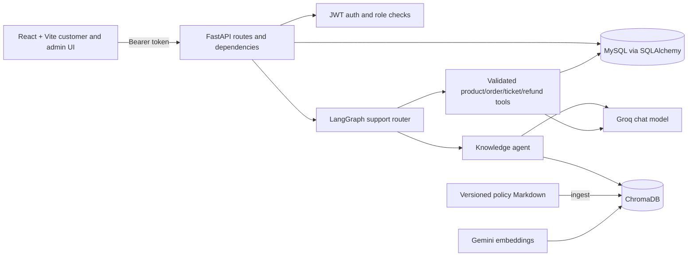

# SupportSphere — E-commerce Customer Support

A demo e-commerce support application with a React/Vite customer workspace,
FastAPI APIs, MySQL persistence, JWT authentication, controlled support tools,
LangGraph routing, and versioned policy retrieval using ChromaDB and Gemini
embeddings. Groq-hosted chat models are used through a provider service.

This repository implements the requested customer and administrator
workflows as a working demo. It is not a production deployment; see
[Known limitations](#known-limitations) for remaining operational constraints.

## Implemented workflows

- **Authentication:** customer signup/login, server-provided roles, protected
  customer/admin routes, role-aware redirects, and session cleanup on an
  authenticated `401`.
- **Customer workspace:** product search, category and price filters,
  lookahead pagination, product details, owned order list/details, support
  ticket list/detail/create/reply, and tracked return/refund requests.
- **AI support:** product cards, policy citations, order/ticket/refund tools,
  mixed policy-and-product responses, detail-collection follow-ups for
  support requests, out-of-domain refusal, request loading and error states,
  and duplicate-submit protection.
- **Admin workspace:** overview statistics, customer details and
  activation/deactivation, product CRUD, all-order status updates, filtered
  ticket review/replies/status/priority/assignment, and refund approval or
  rejection.
- **Authorization:** the backend remains authoritative for ownership and
  roles; UI route guards do not replace API checks.

## Screenshots

No screenshots are currently included in the repository. Capture the login,
customer product/order/ticket/chat, and admin dashboard workflows before
publishing a release or demo package.

## Architecture



The support graph classifies before invoking an agent. Out-of-domain and
recognized instruction-override attempts receive a deterministic refusal;
they skip retrieval and tools. Mixed policy and catalogue requests use both
paths and return policy citations plus structured product results. Customer
identity is taken from authenticated backend context rather than user text or
model-generated arguments. Refund/return requests are tracked for administrator
review and never execute a payment.

## Requirements

- Python 3.13 (the verified local environment) and pip
- Node.js/npm
- MySQL 8-compatible server and database
- Groq API key for generated assistant responses
- Google API key for Gemini embeddings and Chroma ingestion/retrieval

Provider keys are only required for provider-backed operations. Unit tests and
the offline routing/refusal evaluation mock providers or avoid network access.

## Setup

### Backend

From PowerShell:

```powershell
cd D:\GenAI_Project\customer-support-ai\backend
py -3.13 -m venv .venv
.\.venv\Scripts\Activate.ps1
python -m pip install -r requirements.txt
Copy-Item .env.example .env
```

Edit `backend\.env` locally:

- Set the MySQL connection values. Create the configured database first.
- Set `GROQ_API_KEY` and `GOOGLE_API_KEY`.
- Replace `JWT_SECRET_KEY` with a unique random secret of at least 32 bytes.
- Set unique `SEED_ADMIN_PASSWORD` and `SEED_CUSTOMER_PASSWORD` values, each
  at least 12 characters, before seeding.

Never commit `.env` or paste secret values into source files. If a credential
was ever copied into a shared example or repository, revoke/rotate it with its
provider and update the local `.env`.

For a new database, apply the versioned schema and seed the demo database:

```powershell
.\.venv\Scripts\python.exe -m alembic upgrade head
.\.venv\Scripts\python.exe seed_data.py
```

`alembic upgrade head` is the canonical schema workflow. `create_tables.py`
remains available as a compatibility helper for existing installations that
still need its additive legacy schema updates; do not treat it as a substitute
for Alembic migration history. Run migrations against the intended database
after taking a backup. `DATABASE_URL` can override the standard MySQL settings,
which is also used by isolated SQLite migration tests.

The idempotent seed includes two admin accounts, twelve customer accounts,
thirty products, demo orders/items, and sample tickets. Seed login email
addresses use `admin1@support.local`, `admin2@support.local`, and
`customer01@example.in` through `customer12@example.in`; the password is the
value supplied in the corresponding seed environment variable. Avoid using
these shared demo accounts outside a local/demo environment.

Start the API:

```powershell
.\.venv\Scripts\python.exe -m uvicorn app.main:app --reload
```

API health is at `http://127.0.0.1:8000/health`; interactive API docs are at
`http://127.0.0.1:8000/docs`.

### Knowledge base

The five versioned sample policies live in `backend\knowledge_base\`. After
setting a Google API key:

```powershell
cd D:\GenAI_Project\customer-support-ai\backend
.\.venv\Scripts\python.exe index_knowledge.py
```

The script chunks documents, embeds them with Gemini, and stores them in the
local `backend\data\chroma` collection. Re-run it after changing policy files.
The loader uses the newest version per policy and rejects mismatched filename
and document-header versions. Policy content is sample/demo content, not a
merchant's legal terms.

### Frontend

In another PowerShell terminal:

```powershell
cd D:\GenAI_Project\customer-support-ai\frontend
npm install
Copy-Item .env.example .env
npm run dev
```

The frontend example points to `http://127.0.0.1:8000`. Set
`VITE_API_BASE_URL` in `frontend\.env` if the backend is hosted elsewhere.

## Demo

The demo exercises a product lookup, policy question, mixed request, and
out-of-domain refusal through the support graph. It then creates a support
ticket through the authenticated ticket API and creates or reports an existing
tracked return request for an eligible delivered order through the refund API.
This script does not submit its refund scenario through chat. No real
payment/refund is made.

Set the seeded customer's credentials in the backend process environment:

```powershell
$env:DEMO_EMAIL = "customer01@example.in"
$env:DEMO_PASSWORD = "<the value used for SEED_CUSTOMER_PASSWORD>"
```

With the backend running, use another terminal:

```powershell
cd D:\GenAI_Project\customer-support-ai\backend
$env:DEMO_EMAIL = "customer01@example.in"
$env:DEMO_PASSWORD = "<the value used for SEED_CUSTOMER_PASSWORD>"
.\.venv\Scripts\python.exe demo.py
```

Optionally set `API_BASE_URL` or `DEMO_ORDER_ID`. If `DEMO_ORDER_ID` is unset,
the script selects one of the authenticated customer's delivered orders. The
backend remains authoritative for ownership, delivery status, policy window,
and pending duplicate checks; a request can therefore be rejected if no
eligible order exists.

## Tests and evaluation

Backend tests use in-memory SQLite and do not require live LLM calls:

```powershell
cd D:\GenAI_Project\customer-support-ai\backend
.\.venv\Scripts\python.exe -m pytest
.\.venv\Scripts\python.exe -m compileall -q app tests create_tables.py seed_data.py demo.py evaluate_assistant.py
```

Frontend checks:

```powershell
cd D:\GenAI_Project\customer-support-ai\frontend
npm test
npm run build
npm run lint
```

The evaluation data is in `backend\tests\rag_evaluation_cases.json` (45 cases,
including eight prompt-injection cases). Run all metrics with configured Gemini
credentials and the currently indexed collection:

```powershell
cd D:\GenAI_Project\customer-support-ai\backend
.\.venv\Scripts\python.exe evaluate_assistant.py
```

For provider-independent router/refusal metrics:

```powershell
.\.venv\Scripts\python.exe evaluate_assistant.py --skip-retrieval
```

The evaluation reports routing accuracy, expected policy-source retrieval
success, and exact safe-refusal coverage for designated guardrail cases.
Retrieval results depend on the embedding model, index contents, and configured
distance threshold; re-run after changing policies or RAG settings. The
average latency is the mean across measured router, refusal-graph, and
retrieval operations; it is an evaluation-process metric, not a production
user-facing SLO. Last recorded full local run: 45/45 routing cases (100%),
12/12 expected retrieval cases (100%), 15/15 designated safe refusals (100%),
and 215.77 ms average evaluation-operation latency.

## Security notes

- Signup creates customers only; admin roles are assigned through controlled
  seed/admin flows.
- Protected customer endpoints derive identity from the JWT and restrict
  access to the caller's own records. Admin APIs use a reusable role check.
- LLMs cannot issue SQL. Business tools use fixed SQLAlchemy ORM queries and
  validated tool arguments.
- CORS is restricted to `FRONTEND_ORIGIN`. Authenticated requests use bearer
  access tokens; the current frontend stores them in session storage.
- API requests receive an `X-Request-ID`. Application events use allowlisted
  structured fields; passwords, tokens, API keys, and full chat bodies are
  excluded. Login/signup are limited per client IP and chat per authenticated
  user (unauthenticated chat endpoints use the client IP).
- Chat/request lengths, graph recursion, provider timeouts/retries, and tool
  call count are bounded. API errors avoid exposing provider details.
- Retrieved policy text and user messages are treated as untrusted content.
- The root `.gitignore` excludes `.env`, virtual environments, `node_modules`,
  `__pycache__`, and the local Chroma data directory while retaining the
  checked-in `.env.example` templates.

### Token-storage decision

The current `sessionStorage` approach is simple, scoped to a browser tab, and
cleared when the tab session ends, but JavaScript can read it; an XSS flaw can
therefore expose a bearer token. A `Secure`, `HttpOnly`, appropriately
`SameSite` cookie prevents JavaScript from reading the token and is the
recommended production direction, but requires coordinated backend cookie,
CORS, and CSRF protections. Token storage has not been changed pending owner
approval.

## Known limitations

- The UI is a single-page demo and does not persist or restore chat
  conversations across reloads.
- The frontend has no refresh-token flow. Access tokens expire and users must
  sign in again.
- Rate-limit counters are in memory and local to one API process. Multi-worker
  or multi-instance deployments need shared storage (for example Redis) for
  global enforcement. Limits are configurable through the four
  `AUTH_RATE_LIMIT_*` and `CHAT_RATE_LIMIT_*` environment variables.
- Return eligibility uses the sample versioned policy's seven-calendar-day
  window and depends on a recorded delivery timestamp. Refund requests are
  tracked for admin review; no payment or refund is executed.
- Provider behavior is not covered by offline tests; external API availability,
  quotas, model/tool-calling behavior, and live production retrieval require
  deployment-specific validation.
- `create_tables.py` remains for compatibility; Alembic is the canonical,
  versioned migration history. Existing production databases require a
  reviewed migration/adoption plan before switching schema-management methods.
- The evaluation measures the deterministic router, expected policy-source
  retrieval, and exact guardrail refusals; it does not measure generated
  response quality or replace live provider evaluation.
- Session tokens remain JavaScript-readable until an httpOnly-cookie migration
  is explicitly approved and implemented.
- The project is a demo foundation, not a production deployment: add operational
  monitoring, backups, deployment secrets management, privacy/legal review,
  and load testing before serving real customers.
