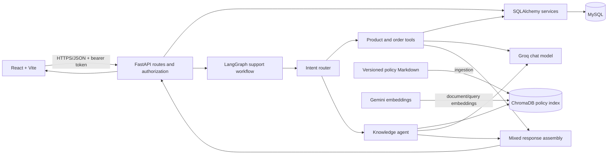
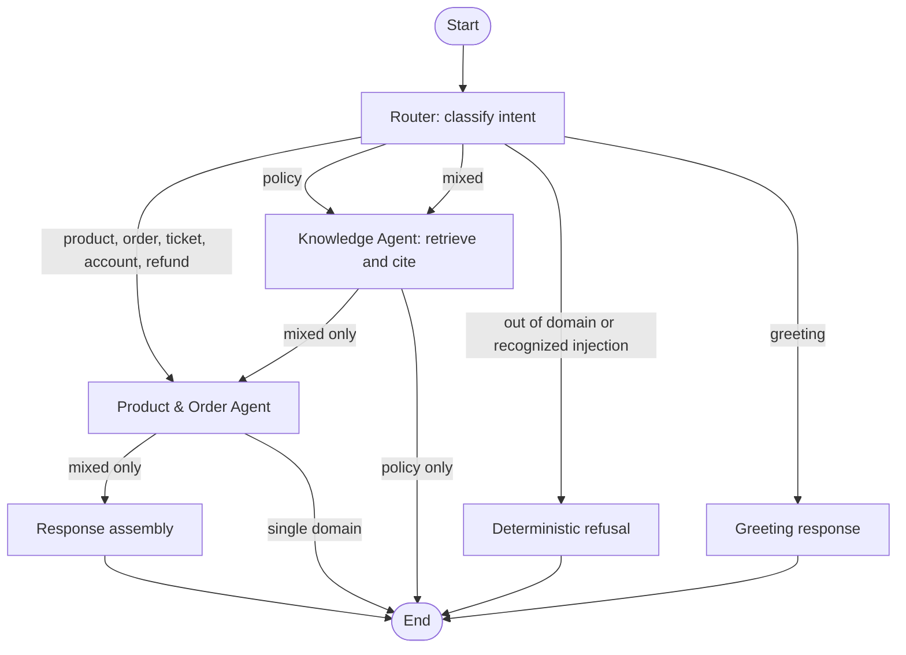
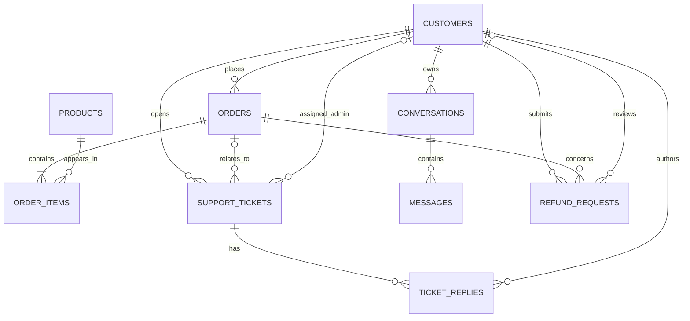

# SupportSphere

An e-commerce support application with role-based workflows and a policy-grounded, multi-agent assistant.

[](https://www.python.org/)
[](https://fastapi.tiangolo.com/)
[](https://react.dev/)
[](https://www.mysql.com/)
[](https://langchain-ai.github.io/langgraph/)
[](./LICENSE)

## 1. Overview

Online stores commonly split product discovery, order tracking, policy questions, and support requests across separate workflows.
SupportSphere brings those customer tasks into one React application backed by FastAPI and MySQL.
Its LangGraph assistant routes in-domain questions to controlled business tools or a policy retrieval workflow.
The assistant uses Groq for chat generation and ChromaDB with Gemini embeddings for policy retrieval.
It is a local/demo project; provider behavior, live deployment, and production load have not been measured.

### 30-second pitch

- Customers can browse products, check their own orders, create support tickets, and track return/refund requests.
- Admins can manage customers, products, orders, tickets, and refund-request reviews.
- A bounded LangGraph routes product/order support, policy, mixed, and out-of-domain requests.
- Business tools use validated SQLAlchemy operations and authenticated customer context rather than model-generated SQL.
- Policy answers use retrieved, versioned documents and return source citations.

## 2. Table of contents

- [Demo](#3-demo)
- [Features](#4-features)
- [Architecture](#5-architecture)
- [Tech stack](#6-tech-stack)
- [Database design](#7-database-design)
- [AI design decisions](#8-ai-design-decisions)
- [Project structure](#9-project-structure)
- [Quick start](#10-quick-start)
- [Environment variables](#11-environment-variables)
- [Development-only demo accounts](#12-development-only-demo-accounts)
- [API reference](#13-api-reference)
- [Testing and evaluation](#14-testing-and-evaluation)
- [Security](#15-security)
- [Limitations and known issues](#16-limitations-and-known-issues)
- [Future improvements](#17-future-improvements)
- [Troubleshooting](#18-troubleshooting)
- [Contributing, license, and author](#19-contributing-license-and-author)
- [Needs my verification](#20-needs-my-verification)

## 3. Demo

- **Live application:** [Not deployed — add URL]
- **Demo video:** [Not recorded — add video link]

Screenshots are placeholders; the image files are not included yet. Add screenshots at these paths and replace the links:

| Screenshot | Caption |
|---|---|
| [docs/screenshots/login.png](docs/screenshots/login.png) | Login and account creation |
| [docs/screenshots/products.png](docs/screenshots/products.png) | Product search and filters |
| [docs/screenshots/chat-citations.png](docs/screenshots/chat-citations.png) | Assistant response with policy citations |
| [docs/screenshots/admin-dashboard.png](docs/screenshots/admin-dashboard.png) | Admin overview and navigation |
| [docs/screenshots/tickets.png](docs/screenshots/tickets.png) | Customer ticket list and details |

The following are illustrative conversations showing the kinds of requests and response fields supported. They are examples, not captured provider output; exact wording and returned data depend on the database, indexed policy set, and model response.

**Product query**

> **Customer:** Find wireless headphones under ₹3000.
> **Assistant:** I found matching products.
> **Product card:** AeroTune Wireless Headphones · ₹2799.00 · stock shown from the catalogue.

**Policy query with citation**

> **Customer:** What is the return window?
> **Assistant:** I can answer from the current returns policy.
> **Citation:** `returns_policy_v1.md` · version and effective date are returned with the cited excerpt.

**Mixed query**

> **Customer:** Can I return my order? Also show wireless headphones under ₹3000.
> **Assistant:** The policy response and catalogue results are combined; the answer includes policy citations and structured product cards when available.

**Refund request**

> **Customer:** I want a refund for order 123 because the item arrived damaged.
> **Assistant:** The assistant may ask for missing details. A request is accepted only when the authenticated customer owns an eligible delivered order within the configured policy window. The request is tracked for admin review; no payment is executed.

**Out-of-domain refusal**

> **Customer:** Who won yesterday's match?
> **Assistant:** Sorry, that's outside my domain. I can help with products, orders, returns, refunds, shipping, warranty, account help, and support tickets.

## 4. Features

### Customer

- Sign up and log in; new signups receive the customer role.
- Browse and search active products by category and price, with pagination and product details.
- View personal orders and order items.
- Create tickets, read ticket details, and reply in a ticket conversation.
- Create and track return/refund requests for eligible orders.
- Use the assistant for supported product, order, ticket, and policy questions.

### Admin

- View dashboard counts for customers, orders, tickets, and recorded order-item totals.
- List customer profiles and activate or deactivate customer accounts.
- Create, edit, list, and deactivate products.
- View all orders and update order status.
- Filter tickets and update status, priority, and assignment; view and reply to tickets.
- Review pending refund requests by approving or rejecting them. This records a decision only; it does not issue a payment.

### AI assistant

- Routes supported requests to product/order tools, policy retrieval, or both for mixed requests.
- Returns structured product results and policy citations when evidence is retrieved.
- Refuses out-of-domain requests before retrieval or business tools run.
- Detects common prompt-injection attempts (for example, requests to ignore prior instructions or reveal the system prompt) and short-circuits them.
- Uses authenticated backend context for customer-specific operations; it does not take customer identity from the prompt.

## 5. Architecture

### System



### LangGraph workflow



### Request lifecycle

1. The browser sends a JSON request to FastAPI; authenticated requests include the bearer access token.
2. FastAPI validates the request, resolves the user from the token, applies role/ownership checks, and assigns a request ID.
3. For assistant messages, the router classifies intent before selecting any agent.
4. Out-of-domain and recognized injection requests return a deterministic refusal without calling tools or policy retrieval.
5. In-domain business operations use validated tools backed by SQLAlchemy; policy requests retrieve relevant chunks from ChromaDB.
6. Mixed requests combine the policy and business-agent results; the API returns answer text plus structured citations/products where applicable.
7. Structured logs contain allowlisted operational fields and the request ID, not full user messages or credentials.

See [docs/architecture.md](docs/architecture.md) for additional component and trust-boundary details.

## 6. Tech stack

| Layer | Technology | Purpose |
|---|---|---|
| Web UI | React 19, Vite 8, React Router | Customer/admin interface and client-side navigation |
| API | Python 3.13, FastAPI, Pydantic | HTTP endpoints, validation, dependency-based authorization |
| Persistence | MySQL, SQLAlchemy 2 | Relational customer, catalogue, order, ticket, conversation, and refund data |
| Schema changes | Alembic | Versioned database migrations |
| Workflow orchestration | LangGraph | Bounded intent routing and agent workflow |
| Chat model | Groq through `langchain-groq` | Assistant response generation |
| Knowledge retrieval | ChromaDB, Gemini embeddings | Vector search over versioned support policies |
| Tests | Pytest; Vitest, React Testing Library | Backend and frontend verification |
| Lint/build | oxlint; Vite | Frontend lint and production bundle |

## 7. Database design

The application models are relational SQLAlchemy tables. `alembic_version` is maintained by Alembic to record migration state; it is not a business entity.



| Table | Description |
|---|---|
| `customers` | Customer/admin identity, password hash, role, and active state. |
| `products` | Product catalogue, category, price, stock, and active state. |
| `orders` | Customer order status and delivery timestamps. |
| `order_items` | Product, quantity, and unit price captured for an order. |
| `support_tickets` | Customer support issues, status, priority, related order, and optional admin assignment. |
| `ticket_replies` | Messages and authors attached to a support ticket. |
| `conversations` | Customer-owned persisted conversation records. |
| `messages` | Conversation messages and optional source metadata. |
| `refund_requests` | Tracked return/refund requests and admin review outcome; no payment execution. |

## 8. AI design decisions

- **Why multi-agent routing:** product/order operations and policy answers require different data sources and controls. The router selects a bounded workflow, and mixed questions can use both branches.
- **Why controlled tools instead of raw SQL:** tools validate arguments and call fixed ORM/service operations. The model cannot construct or execute arbitrary SQL.
- **Why RAG:** policy answers need to cite the versioned policy evidence and abstain when no relevant source is retrieved.
- **Why MySQL and ChromaDB are separate:** MySQL stores mutable structured application records and relationships; ChromaDB stores searchable policy chunks and embeddings. Each is used for a different query pattern.
- **How tool authorization works:** FastAPI derives the customer ID from the signed bearer token and supplies it to the graph as trusted context. Customer-specific tool queries filter by that ID; the prompt and model arguments do not set identity.
- **How out-of-domain requests are blocked:** deterministic routing checks unsupported requests and common instruction-overrides before graph agent selection. The refusal node returns directly without calling tools or retrieval.
- **Trade-offs:** deterministic intent patterns are fast and testable but need maintenance as phrasing evolves. Similarity thresholds can reject useful evidence or admit weak matches and must be monitored when policies or embeddings change. Groq and Gemini calls require external credentials and availability.

## 9. Project structure

```text
customer-support-ai/
├── backend/
│   ├── alembic/                 # Versioned database migrations
│   ├── app/
│   │   ├── agents/              # Intent classification and LangGraph workflow
│   │   ├── api/                 # FastAPI route modules
│   │   ├── core/                # Settings, security, rate limits, request IDs, logging
│   │   ├── models/              # SQLAlchemy entities
│   │   ├── schemas/             # Pydantic request/response models
│   │   └── services/            # ORM operations, providers, tools, and retrieval
│   ├── data/chroma/             # Local Chroma index (generated; do not commit)
│   ├── knowledge_base/          # Versioned policy Markdown
│   ├── tests/                   # Pytest suite and evaluation cases
│   ├── create_tables.py         # Compatibility schema helper
│   ├── demo.py                  # Authenticated API demonstration
│   ├── evaluate_assistant.py    # Routing, retrieval, and refusal evaluation
│   ├── index_knowledge.py       # Policy chunking and Chroma ingestion
│   ├── requirements.txt         # Pinned Python dependencies
│   └── seed_data.py             # Idempotent demo data seeding
├── docs/
│   └── architecture.md          # Deeper architecture and request flow
├── frontend/
│   ├── public/                  # Static frontend assets
│   ├── src/
│   │   ├── api/                 # Browser-to-FastAPI client functions
│   │   ├── components/          # Admin, ticket, and refund views
│   │   ├── App.jsx              # Main routes and customer workspace
│   │   └── App.test.jsx         # Vitest and Testing Library workflows
│   ├── package.json             # Frontend scripts and dependencies
│   └── vite.config.js            # Vite and Vitest configuration
├── .gitignore
├── LICENSE
└── README.md
```

## 10. Quick start

### Prerequisites

| Tool | Version / requirement |
|---|---|
| Python | Python 3.13 was used for the current test run. |
| Node.js and npm | Node.js 22.16.0 and npm 10.9.2 were used for the current frontend run. |
| MySQL | A MySQL server and an empty application database; the repository does not specify a minimum server version. |
| Provider accounts | Groq for generated chat responses; Google AI Studio/Gemini for embeddings and knowledge ingestion. |

The backend tests use isolated SQLite fixtures and do not require the MySQL QA database. Do not point seed or migration commands at a database containing records you need to preserve.

### Windows: backend setup

Open PowerShell:

```powershell
cd D:\path\to\customer-support-ai\backend
py -3.13 -m venv .venv
.\.venv\Scripts\Activate.ps1
python -m pip install -r requirements.txt
Copy-Item .env.example .env
```

Edit `backend\.env`. Set MySQL connection values, a random `JWT_SECRET_KEY` with at least 32 characters, and unique seed passwords of at least 12 characters. Set provider keys for the assistant and knowledge workflows. Create an empty database matching `DB_NAME` before applying migrations. For example, with the MySQL CLI:

```powershell
mysql -u root -p -e "CREATE DATABASE customer_support_ai CHARACTER SET utf8mb4 COLLATE utf8mb4_unicode_ci;"
```

Apply the versioned schema and seed demo data:

```powershell
python -m alembic upgrade head
python seed_data.py
```

To index policy files (requires `GOOGLE_API_KEY`; embedding calls may use provider quota):

```powershell
python index_knowledge.py
```

Start the backend from the `backend` directory:

```powershell
python -m uvicorn app.main:app --reload
```

### macOS/Linux: backend setup

```bash
cd /path/to/customer-support-ai/backend
python3.13 -m venv .venv
source .venv/bin/activate
python -m pip install -r requirements.txt
cp .env.example .env
```

Edit `.env` with the same values described above. Create an empty MySQL database, then run:

```bash
python -m alembic upgrade head
python seed_data.py
python index_knowledge.py
python -m uvicorn app.main:app --reload
```

`python index_knowledge.py` is only needed for policy retrieval and requires Gemini credentials. Alembic is the canonical schema workflow. `create_tables.py` remains as a compatibility helper; it is not a replacement for Alembic migration history.

### Frontend setup (Windows, macOS, or Linux)

In another terminal:

```text
cd <repository-root>/frontend
npm ci
```

Copy `frontend/.env.example` to `.env` (`Copy-Item .env.example .env` in PowerShell; `cp .env.example .env` on macOS/Linux). Its current `VITE_API_BASE_URL` points to `http://127.0.0.1:8000`. Start Vite:

```text
npm run dev
```

The backend's `FRONTEND_ORIGIN` default is `http://localhost:5173`. If Vite uses another host or port, update `FRONTEND_ORIGIN` and `VITE_API_BASE_URL` to match.

### Verify it works

With the backend running, check health and sign in using a seeded account. Replace the password placeholder with the local value configured in `SEED_CUSTOMER_PASSWORD`; do not commit or share it.

**PowerShell**

```powershell
Invoke-RestMethod http://127.0.0.1:8000/health
$body = @{ email = "customer01@example.in"; password = "<local-seed-customer-password>" } | ConvertTo-Json
Invoke-RestMethod -Method Post -Uri http://127.0.0.1:8000/api/auth/login -ContentType "application/json" -Body $body
```

**macOS/Linux**

```bash
curl -i http://127.0.0.1:8000/health
curl -i -X POST http://127.0.0.1:8000/api/auth/login \
  -H 'Content-Type: application/json' \
  -d '{"email":"customer01@example.in","password":"<local-seed-customer-password>"}'
```

The login response includes an access token and role. API docs are served by FastAPI at `http://127.0.0.1:8000/docs`.

## 11. Environment variables

Copy the checked-in templates; never commit your `.env` files.

### Backend (`backend/.env.example`)

| Variable | Required | Description | Placeholder |
|---|---|---|---|
| `APP_NAME` | No | API title; defaults to `Customer Support AI Assistant`. | `Customer Support AI Assistant` |
| `APP_VERSION` | No | API version; defaults to `0.1.0`. | `0.1.0` |
| `FRONTEND_ORIGIN` | For browser CORS | Allowed frontend origin. | `http://localhost:5173` |
| `DB_HOST` | Yes, unless using `DATABASE_URL` | MySQL hostname. | `localhost` |
| `DB_PORT` | Yes, unless using `DATABASE_URL` | MySQL port. | `3306` |
| `DB_NAME` | Yes, unless using `DATABASE_URL` | Existing application database name. | `customer_support_ai` |
| `DB_USER` | Yes, unless using `DATABASE_URL` | MySQL user. | `<mysql-user>` |
| `DB_PASSWORD` | Yes, unless using `DATABASE_URL` | MySQL password. | `<mysql-password>` |
| `DATABASE_URL` | No | Optional SQLAlchemy URL override, also used by isolated tests. | `mysql+pymysql://<user>:<password>@localhost:3306/customer_support_ai` |
| `JWT_SECRET_KEY` | For auth | Random signing secret; use at least 32 characters. | `<random-secret-at-least-32-chars>` |
| `ACCESS_TOKEN_EXPIRE_MINUTES` | No | Access-token expiry. | `30` |
| `GROQ_API_KEY` | For LLM answers | Groq credential used by chat generation. | `<groq-api-key>` |
| `GROQ_MODEL` | No | Groq chat model name. | `llama-3.3-70b-versatile` |
| `GOOGLE_API_KEY` | For indexing/retrieval | Google credential used by Gemini embeddings. | `<google-api-key>` |
| `GEMINI_EMBEDDING_MODEL` | No | Gemini embedding model name. | `gemini-embedding-001` |
| `RAG_TOP_K` | No | Maximum retrieved chunks configured for retrieval. | `3` |
| `RAG_MAX_DISTANCE` | No | Chroma distance cutoff; lower distance indicates closer match. | `1.5` |
| `SEED_ADMIN_PASSWORD` | For seed script | Password shared by locally seeded admin accounts; at least 12 characters. | `<unique-local-admin-password>` |
| `SEED_CUSTOMER_PASSWORD` | For seed script | Password shared by locally seeded customer accounts; at least 12 characters. | `<unique-local-customer-password>` |
| `AUTH_RATE_LIMIT_MAX_REQUESTS` | No | Login/signup fixed-window request limit per client IP. | `5` |
| `AUTH_RATE_LIMIT_WINDOW_SECONDS` | No | Login/signup window duration. | `60` |
| `CHAT_RATE_LIMIT_MAX_REQUESTS` | No | Chat request limit (per user on authenticated graph/tool routes; per IP on unauthenticated chat routes). | `20` |
| `CHAT_RATE_LIMIT_WINDOW_SECONDS` | No | Chat window duration. | `60` |

Get a Groq key from [GroqCloud](https://console.groq.com/keys) and a Gemini/Google AI key from [Google AI Studio](https://aistudio.google.com/apikey). Provider keys are not included in this repository.

### Frontend (`frontend/.env.example`)

| Variable | Required | Description | Placeholder |
|---|---|---|---|
| `VITE_API_BASE_URL` | Yes | Base URL for the FastAPI service. | `http://127.0.0.1:8000` |

## 12. Development-only demo accounts

The seed script creates these accounts; they are for local development/demo only:

| Role | Email | Password |
|---|---|---|
| Admin | `admin1@support.local` | Value supplied through `SEED_ADMIN_PASSWORD` |
| Admin | `admin2@support.local` | Value supplied through `SEED_ADMIN_PASSWORD` |
| Customer | `customer01@example.in` through `customer12@example.in` | Value supplied through `SEED_CUSTOMER_PASSWORD` |

There are no hard-coded demo passwords. Do not use shared demo accounts in a real deployment.

## 13. API reference

Interactive OpenAPI documentation: [`http://127.0.0.1:8000/docs`](http://127.0.0.1:8000/docs) while the backend is running.

All paths below are relative to the API origin. Authenticated endpoints require `Authorization: Bearer <access-token>`.

### Auth

| Method | Endpoint | Role | Description |
|---|---|---|---|
| `POST` | `/api/customers` | Public | Register a customer account. |
| `POST` | `/api/auth/login` | Public | Authenticate and return a bearer token and role. |
| `GET` | `/api/customers/{customer_id}` | Customer, own profile | Get the authenticated customer's profile. |
| `GET` | `/api/customers/admin/all` | Admin | List customers/admins. |
| `GET` | `/api/customers/admin/{customer_id}` | Admin | View a customer profile. |
| `PATCH` | `/api/customers/admin/{customer_id}/active` | Admin | Activate/deactivate a customer. |

### Products

| Method | Endpoint | Role | Description |
|---|---|---|---|
| `GET` | `/api/products` | Public | Search active products; supports query, category, price bounds, limit, and offset. |
| `GET` | `/api/products/categories` | Public | List categories with active products. |
| `GET` | `/api/products/{product_id}` | Public | Get an active product. |
| `GET` | `/api/products/admin/all` | Admin | List products including inactive records. |
| `POST` | `/api/products` | Admin | Create a product. |
| `PATCH` | `/api/products/{product_id}` | Admin | Update product fields. |
| `DELETE` | `/api/products/{product_id}` | Admin | Deactivate a product while preserving order-item references. |

### Orders

| Method | Endpoint | Role | Description |
|---|---|---|---|
| `POST` | `/api/orders` | Customer | Create an order for the authenticated customer. |
| `GET` | `/api/orders` | Customer | List the caller's orders. |
| `GET` | `/api/orders/{order_id}` | Customer, owner only | Get an owned order and its items. |
| `GET` | `/api/orders/admin/all` | Admin | List all orders. |
| `PATCH` | `/api/orders/{order_id}/status` | Admin | Update order status. |

### Tickets

| Method | Endpoint | Role | Description |
|---|---|---|---|
| `POST` | `/api/support-tickets` | Customer | Create a ticket, optionally tied to an owned order. |
| `GET` | `/api/support-tickets` | Customer | List the caller's tickets. |
| `GET` | `/api/support-tickets/{ticket_id}` | Customer owner or admin | View ticket details and replies. |
| `POST` | `/api/support-tickets/{ticket_id}/replies` | Customer owner or admin | Add a ticket reply. |
| `GET` | `/api/support-tickets/admin/all` | Admin | List/filter tickets by status and priority. |
| `PATCH` | `/api/support-tickets/{ticket_id}/status` | Admin | Update ticket status. |
| `PATCH` | `/api/support-tickets/{ticket_id}` | Admin | Update supported ticket fields, including priority/assignment. |

### Chat

| Method | Endpoint | Role | Description |
|---|---|---|---|
| `POST` | `/api/support/ask` | Customer | Main LangGraph workflow; returns answer, intent, agent, citations, and product results. |
| `POST` | `/api/chat/ask` | Public, rate-limited | General LLM response. |
| `POST` | `/api/chat/structured` | Public, rate-limited | Structured answer, intent, and suggested action. |
| `POST` | `/api/chat/agent` | Customer | Legacy controlled-tool assistant endpoint. |
| `POST` | `/api/rag/ask` | Public | Policy retrieval answer with citations. |

Main support request:

```http
POST /api/support/ask
Authorization: Bearer <access-token>
Content-Type: application/json

{"question":"What is the return window?"}
```

Response shape (illustrative; exact answer, citations, and evidence depend on the indexed policy):

```json
{
  "answer": "<answer grounded in retrieved policy evidence>",
  "intent": "policy_question",
  "selected_agent": "knowledge",
  "sources": ["returns_policy_v1.md"],
  "citations": [
    {
      "source": "returns_policy_v1.md",
      "policy": "returns_policy",
      "version": "<indexed version>",
      "effective_date": "<indexed effective date>",
      "excerpt": "<retrieved policy excerpt>"
    }
  ],
  "products": [],
  "retrieved_chunks": 1
}
```

### Admin and refunds

| Method | Endpoint | Role | Description |
|---|---|---|---|
| `GET` | `/api/admin/dashboard` | Admin | Customer/order/ticket counts and recorded order-item total. |
| `GET` | `/api/admin/refund-requests` | Admin | List tracked refund/return requests. |
| `PATCH` | `/api/admin/refund-requests/{request_id}` | Admin | Approve or reject a pending request; does not execute payment. |
| `POST` | `/api/refund-requests` | Customer | Create a tracked request for an eligible owned order. |
| `GET` | `/api/refund-requests` | Customer | List the caller's requests. |

### Conversations

| Method | Endpoint | Role | Description |
|---|---|---|---|
| `POST` | `/api/conversations` | Customer | Create an owned conversation record. |
| `GET` | `/api/conversations` | Customer | List owned conversation records. |
| `GET` | `/api/conversations/{conversation_id}` | Customer, owner only | Get one owned conversation and messages. |
| `POST` | `/api/conversations/{conversation_id}/messages` | Customer, owner only | Append a customer message to an owned conversation. |

Conversation persistence endpoints exist; the current UI does not restore chat history across reloads.

## 14. Testing and evaluation

Run backend tests from `backend/`:

```powershell
.\.venv\Scripts\python.exe -m pytest
```

macOS/Linux, with the virtual environment activated:

```bash
python -m pytest
```

Run frontend checks from `frontend/`:

```bash
npm test
npm run lint
npm run build
```

Run the complete assistant evaluation from `backend/`. It requires Gemini credentials and an indexed Chroma collection for retrieval checks:

```bash
python evaluate_assistant.py
```

Run routing/refusal checks without retrieval:

```bash
python evaluate_assistant.py --skip-retrieval
```

Latest measured results in this environment:

| Check | Result |
|---|---|
| Backend Pytest | **185 passed**, 1 existing LangChain Community deprecation warning |
| Frontend Vitest | **7 passed** |
| Frontend lint | Passed; no warnings reported |
| Frontend build | Passed |
| Routing | **45/45 (100%)** |
| Expected policy-source retrieval | **12/12 (100%)** |
| Designated safe refusals | **15/15 (100%)** |
| Average evaluation-operation latency | **294.06 ms** |
| Generated response quality / production latency | **Not measured** |

The latency metric is the evaluator's average across measured routing, refusal-graph, and retrieval operations; it is not a user-facing production SLO. Retrieval coverage checks whether expected source filenames were returned for supported evaluation cases.

## 15. Security

- [x] Passwords are stored as password hashes, not plaintext.
- [x] Signup creates customers; admin role access is enforced by backend dependencies.
- [x] Customer order, ticket, conversation, and refund lookups are scoped to authenticated identity.
- [x] Customer-specific tool calls receive trusted backend customer context; model arguments cannot choose another identity.
- [x] Business tools use validated operations and SQLAlchemy; the LLM is not given arbitrary SQL execution.
- [x] User content and retrieved policy text are treated as untrusted; common injection/out-of-domain requests short-circuit before tools and RAG.
- [x] Login/signup and chat routes have configurable in-memory rate limits and return `Retry-After` when limited.
- [x] API requests receive an `X-Request-ID`; structured logs use allowlisted fields and avoid full message bodies and credentials.
- [x] CORS origin is configurable; `.env`, virtual environments, `node_modules`, and Chroma data are ignored by Git.
- [x] Provider errors return safe client-facing messages.

**Token storage:** the frontend currently keeps the bearer token in `sessionStorage`. This is simple and scoped to the browser tab, but JavaScript can read it; an XSS issue could expose the token. For production, an `HttpOnly`, `Secure`, appropriately `SameSite` cookie is recommended, together with CSRF protections and coordinated API/CORS changes. Cookie-based storage has not been implemented.

The current rate limiter is process-local; multiple backend workers/instances do not share counters.

## 16. Limitations and known issues

- This repository has no production deployment URL, demo video, or screenshots yet.
- This project is a demo foundation, not a production-ready hosted service.
- Provider-backed chat and policy answers require external Groq/Gemini credentials and network availability.
- The evaluation measures routing, expected source retrieval, and exact refusal coverage; it does not assess answer quality, user satisfaction, or production performance.
- The local indexed Chroma data is generated separately and is not included in Git. Policy Q&A requires indexing the versioned documents.
- The UI does not restore persisted conversations after reload, despite conversation storage APIs being present.
- There is no refresh-token flow; users sign in again after access-token expiry.
- Rate-limit counters are in memory and per-process. Distributed deployment needs shared storage for consistent enforcement.
- Refund/return requests are tracked for review only. The sample return window is read from the versioned policy; no payment is issued.
- Existing production MySQL databases need a reviewed migration/adoption plan before applying the initial Alembic revision.
- The backend test run reports an existing `langchain-community` deprecation warning.

## 17. Future improvements

- Add screenshots, a recorded end-to-end demo, and a hosted demo URL.
- Add shared rate-limit storage for multi-worker deployments.
- Consider migrating from `sessionStorage` to secure `HttpOnly` cookies with CSRF protections.
- Add chat-history restoration and a refresh-token/session lifecycle.
- Add live-provider evaluation for answer correctness, citation faithfulness, and latency under representative load.
- Add migration adoption guidance and a production database backup/restore procedure.
- Replace deprecated dependencies where maintained integrations are available.
- Add deployment observability, load testing, and operational alerts before serving real customers.

## 18. Troubleshooting

| Symptom | Likely cause | What to check |
|---|---|---|
| MySQL connection refused or access denied | MySQL is stopped, database/user/password is wrong, or the database does not exist. | Check `DB_HOST`, `DB_PORT`, `DB_NAME`, `DB_USER`, and `DB_PASSWORD`; create an empty database before migration. |
| Browser reports a CORS error | Browser origin differs from `FRONTEND_ORIGIN`. | Set `FRONTEND_ORIGIN` to the exact Vite origin, restart FastAPI, and verify frontend `VITE_API_BASE_URL`. |
| Assistant reports provider unavailable | Missing/invalid Groq key, quota, network, or provider issue. | Set `GROQ_API_KEY`; inspect server logs by request ID without logging the key. |
| Policy questions return no evidence | Chroma index is absent, stale, or pointed at a different backend data directory. | Set `GOOGLE_API_KEY`, run `python index_knowledge.py` from `backend/`, and check `RAG_TOP_K`/`RAG_MAX_DISTANCE`. |
| Gemini embedding call fails | Missing/invalid Google AI key, model access, or network issue. | Verify `GOOGLE_API_KEY` and `GEMINI_EMBEDDING_MODEL`; then retry ingestion/evaluation. |
| Port 8000 or 5173 is occupied | Another process is using the development port. | Stop that process or use a free port; if Vite changes ports, update `FRONTEND_ORIGIN` to its actual origin. |
| Alembic cannot connect or migration fails | Database is unavailable, URL is malformed, or schema state is not the expected initial state. | Confirm database settings and empty target database; inspect Alembic output. Do not run the initial migration blindly against a populated production database. |
| Login fails after seeding | Seed passwords were unset/too short or login uses the wrong shared seed password. | Set both seed variables to at least 12 characters before running `python seed_data.py`; use the matching role's password at login. |

## 19. Contributing, license, and author

### Contributing

1. Create a branch for your change.
2. Keep changes scoped and add/update tests for behavior changes.
3. Run backend tests and frontend test/lint/build commands before opening a pull request.
4. Never commit `.env` files, API keys, passwords, database dumps, or the Chroma index.

### Author

- **Name:** `Arbaaz Shaikh`
- **LinkedIn:** `https://www.linkedin.com/in/arbaaz-shaikh-3878a520a/`
- **GitHub:** `https://github.com/arbaaz65dac`
- **Email:** `arbaazshaikh8757@gmail.com`

## 20. Needs my verification

- Add the actual application URL and demo video link when available.
- Add real screenshots at the documented `docs/screenshots/` paths.
- Replace author placeholders with your public profile/contact details.
- Confirm MySQL server version and run the first-time setup against your own empty local database; this environment's migration integration test used isolated SQLite.
- Add project-specific contribution/contact details if you want a different process.
