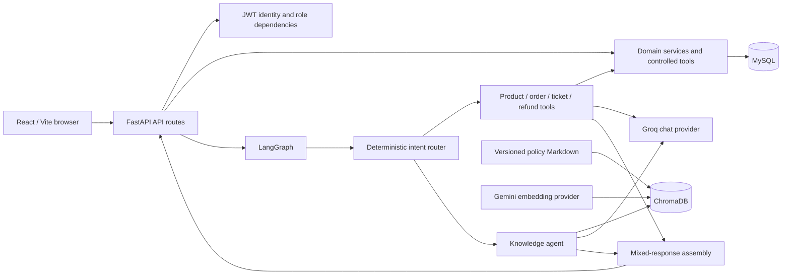
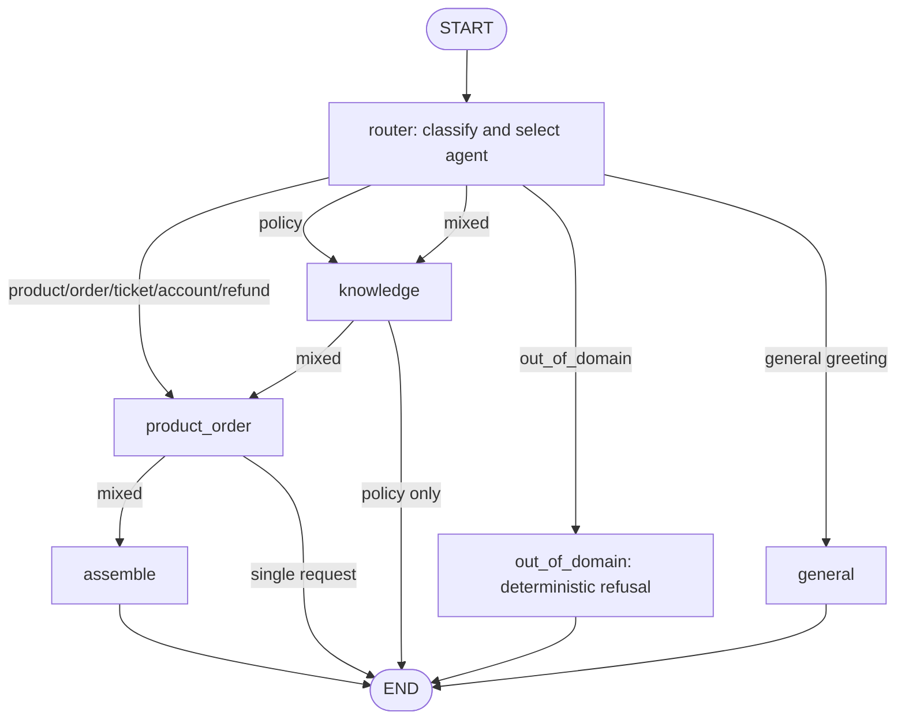

# SupportSphere architecture

This note describes the current code paths and boundaries. It documents the local/demo implementation, not a deployed production topology.

## Components

| Component | Code location | Responsibility |
|---|---|---|
| React client | `frontend/src/App.jsx`, `frontend/src/api/` | Login/session state, customer/admin navigation, API calls, product/order/ticket/refund workflows, and assistant rendering. |
| Admin/customer views | `frontend/src/components/` | Dedicated ticket, refund, and admin workspaces. |
| FastAPI application | `backend/app/main.py` | Registers route modules, restricts CORS to configured origin, configures request-ID middleware and logging. |
| Authentication | `backend/app/api/auth_routes.py`, `backend/app/core/security.py`, `backend/app/services/auth_service.py` | Verifies passwords, issues bearer tokens, resolves current customer, and checks admin role. |
| Domain APIs | `backend/app/api/`, `backend/app/services/` | Validates requests and performs authorized SQLAlchemy operations. |
| Relational persistence | `backend/app/models/`, `backend/app/database.py` | SQLAlchemy models and MySQL database connection; `DATABASE_URL` can override individual MySQL settings. |
| Migration and demo data | `backend/alembic/`, `backend/seed_data.py` | Alembic schema history and idempotent development data seeding. |
| Assistant graph | `backend/app/agents/` | Intent classification, bounded branch selection, out-of-domain refusal, and mixed-response assembly. |
| Controlled tools | `backend/app/services/agent_tools.py`, `tool_agent_service.py` | Validated product/order/ticket/refund operations using SQLAlchemy and trusted customer context. |
| Policy retrieval | `backend/app/services/document_service.py`, `vector_store_service.py`, `rag_service.py` | Loads versioned Markdown, embeds/indexes and retrieves policy passages, and prepares citations. |
| Provider boundary | `backend/app/services/provider_service.py` | Creates Groq chat and Gemini embedding clients. |
| Local vector index | `backend/data/chroma/` | Generated Chroma collection; excluded from Git and not managed by Alembic. |

## System context

## Assistant graph and routing

The graph has a `MAX_GRAPH_STEPS` recursion limit applied by the authenticated support route. The router is deterministic pattern-based classification. `out_of_domain` is selected before the knowledge or product/order agent, so these requests do not reach retrieval or business tools. A `mixed` request runs the knowledge path and then the product/order path before response assembly.

## Request and trust boundaries

1. The browser sends JSON to a route. Protected routes require a bearer access token.
2. The FastAPI dependency validates the token and looks up the active customer. Admin routes additionally require the `admin` role.
3. Customer-specific service queries filter by the authenticated customer ID. The support graph receives this ID through server-supplied runtime context; prompt text and model-generated tool arguments cannot provide the trusted identity.
4. Pydantic request schemas constrain message lengths and operation values. Tools validate product search filters and ownership/eligibility for order, ticket, and refund operations.
5. Product, order, ticket, and refund data stays in SQLAlchemy-backed relational services. Policy retrieval reads from ChromaDB and returns source metadata/excerpts.
6. User messages and retrieved documents are untrusted input. Recognized prompt-injection patterns short-circuit; retrieved text is supplied to the RAG prompt as evidence, not instructions.
7. Request middleware generates an `X-Request-ID`. Structured logging is allowlisted to operational fields and excludes full request bodies and credentials.
8. The API returns safe error messages. Return/refund requests are records for admin review; payment execution is outside this project.

## Data stores

- **MySQL:** mutable relational records, foreign keys, transactional service operations, and role/ownership-filtered queries.
- **ChromaDB:** embeddings and chunks from versioned policy Markdown, searched by semantic similarity and filtered using a configured distance threshold.
- **Alembic:** manages schema revisions in MySQL (or an isolated database URL for tests); it does not manage policy index contents.

## Development setup lifecycle

1. Configure backend variables in `backend/.env`; create the database separately.
2. Run `python -m alembic upgrade head` from `backend/`.
3. Run `python seed_data.py` to add local development accounts, products, orders, and tickets.
4. Run `python index_knowledge.py` when setting up policy retrieval or changing the indexed policies.
5. Run FastAPI and Vite in separate terminals. The frontend calls the backend using `VITE_API_BASE_URL`.
6. Validate with the Pytest suite, frontend tests/lint/build, and `python evaluate_assistant.py`.

## Operational limits

- In-memory rate-limit state is local to one backend process.
- The frontend stores access tokens in `sessionStorage`; they are readable by JavaScript.
- The browser UI does not restore persisted conversations after reload.
- Live provider answer quality and production throughput have not been measured.
